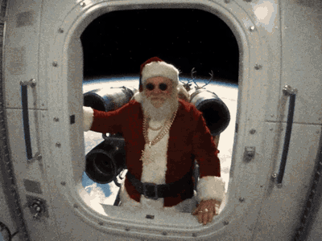

# Angle dynamique

Un skill gratuit pour Claude (et les autres agents IA) qui rend tes vidéos IA dynamiques : fausse vidéo amateur de 2005, caméra levée, crash zoom, GoPro grand angle, whip pan, secousses, et un truc qui se passe toutes les 2 secondes.

**[Télécharger le skill en ZIP](https://github.com/AISTUDIOOSS/angle-dynamique/archive/refs/heads/main.zip)**, aucun compte nécessaire.

## Ce qu'il fait

- Tu lui donnes **une vidéo, une idée ou un prompt**.
- Il découpe la scène en plans de 2 à 4 secondes, choisit un mouvement de caméra par plan (17 mouvements, avec leur vrai nom) et te montre le découpage.
- Il réécrit le prompt plan par plan pour Seedance, Kling, Veo ou Higgsfield, avec les règles qui évitent les plans plats (jamais de face, toutes les fiches de référence, crash zoom en vrai zoom d'objectif…).
- Il te donne les effets à faire au montage (crash zoom, punch-in, whip pan, secousses) et la couche « vidéo 2005 » qui casse le rendu trop propre de l'IA.

## Installer

**Claude Code** : copie le dossier `angle-dynamique` dans `~/.claude/skills/`. Ou envoie ce message à Claude :

> Installe le skill Angle dynamique : télécharge https://github.com/AISTUDIOOSS/angle-dynamique/archive/refs/heads/main.zip, copie le dossier angle-dynamique dans ~/.claude/skills/, puis dis-moi quand c'est prêt.

**Claude.ai / Claude Desktop** : Réglages → Capacités → Skills → importer le dossier `angle-dynamique` en ZIP.

**Codex** : copie le dossier `angle-dynamique` dans `~/.codex/skills/`.

Ouvre ensuite une nouvelle conversation et écris par exemple : « Utilise le skill angle dynamique sur cette idée : un chat qui fait un braquage dans une supérette. »

## Contenu

| Fichier | Rôle |
|---|---|
| `angle-dynamique/SKILL.md` | La méthode, étape par étape |
| `angle-dynamique/references/mouvements.md` | Les 17 mouvements et les mots du prompt |
| `angle-dynamique/references/prompt-modele.md` | Le modèle de prompt, avec un exemple rempli |
| `angle-dynamique/references/montage.md` | Les mouvements au montage, avec les commandes FFmpeg |
| `angle-dynamique/scripts/couche-2005.sh` | Applique la couche « vidéo 2005 » à une vidéo finie |

## Limites

- Le skill écrit les prompts ; la génération se fait dans ton outil, avec ses propres coûts.
- Les commandes de montage demandent FFmpeg (`brew install ffmpeg` sur Mac). Elles sont facultatives : les mêmes réglages se font dans n'importe quel logiciel de montage.

Fait par [AI Studio](https://www.ai-studio-os.com). Licence MIT.
